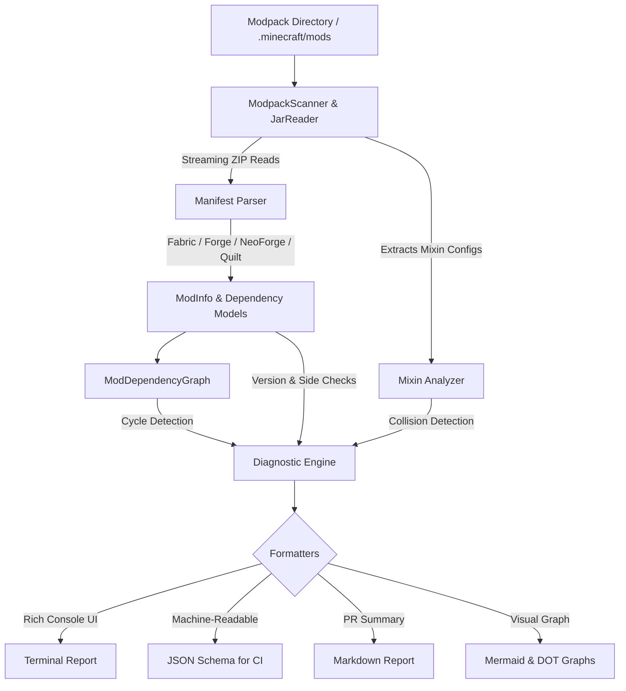

# 🩺 Modpack Doctor

[](LICENSE)
[](pyproject.toml)
[](tests/)
[](.github/workflows/ci.yml)
[](#features)

**Modpack Doctor** is a comprehensive, production-grade CLI diagnostic tool designed for Minecraft modpack creators, server administrators, and CI/CD pipelines. It statically inspects mod JAR archives in-memory without unpacking them to disk, builds dependency resolution graphs, detects version mismatches, identifies duplicate libraries, flags Mixin collisions, and warns against client/server side misconfigurations.

---

## ⚡ Features

- **Multi-Loader Inspection**: Supports **Fabric** (`fabric.mod.json`), **Minecraft Forge** (`META-INF/mods.toml`), **NeoForge** (`META-INF/neoforge.mods.toml`), and **Quilt** (`quilt.mod.json`).
- **Zero-Extraction In-Memory Streaming**: Reads ZIP central directories and streams only manifest and mixin configurations directly into memory. Supports embedded Jar-in-Jar (JiJ) dependencies without extracting files to disk.
- **Dependency Graph Engine**: Resolves complex mod relationships, provides-aliases, and detects circular dependency chains.
- **Universal Version Matcher**: Accurately compares Minecraft versions, snapshots (e.g., `24w10a`), Maven version ranges (`[1.20, 1.21)`, `[1.0,)`), and SemVer ranges (`^`, `~`, `>=`, `<=`, `*`).
- **Mixin Collision Auditor**: Uncovers colliding Mixin configuration filenames (such as generic `mixins.json`) and identical mixin class packages that crash classloaders at launch.
- **Environment Mismatch Diagnostics**: Validates mod environments (`client`, `server`, `both`) against dedicated server or client deployment targets.
- **CI/CD Pipeline Ready**: Provides a specialized `verify` command with configurable exit codes and rich JSON and GitHub-flavored Markdown outputs.
- **100% Test Coverage**: Rigorously tested with automated unit and integration tests enforcing 100% statement and branch coverage.

---

## 🏗️ Architecture



---

## 📦 Installation

### From Source
```bash
git clone https://github.com/your-org/modpack-doctor.git
cd modpack-doctor
pip install -e .
```

### With Developer Dependencies
```bash
pip install -e .[dev]
```

---

## 🚀 Quick Start

### 1. Scan a Modpack Directory
Scan your `.minecraft/mods` or server directory:
```bash
modpack-doctor scan .minecraft/mods/
```

Target a dedicated server pack and check compatibility with Minecraft 1.20.1:
```bash
modpack-doctor scan ./mods --target server --mc-version 1.20.1
```

### 2. CI/CD Validation
Run strict validation in your automated build pipeline:
```bash
modpack-doctor verify ./mods --fail-on-warning --format json -o diagnostic-report.json
```

### 3. Deep Inspect a Single Mod JAR
Inspect manifests, dependencies, mixins, and entrypoints of any mod:
```bash
modpack-doctor inspect ./mods/sodium-fabric-0.5.8.jar
```

### 4. Dependency Graph Visualization
Render the dependency graph as an ASCII tree, Mermaid diagram, or Graphviz DOT:
```bash
# Render ASCII tree
modpack-doctor graph ./mods --format tree

# Focus on a specific root mod
modpack-doctor graph ./mods --format tree --root appleskin

# Export Mermaid diagram for documentation
modpack-doctor graph ./mods --format mermaid -o deps.mermaid
```

### 5. Modpack Diff Comparison
Compare two modpack releases or staging directories:
```bash
modpack-doctor diff ./old-mods ./new-mods
```

---

## 📖 CLI Command Reference

### `modpack-doctor scan [DIR]`
Runs the full diagnostic suite on the specified directory.

| Option | Flag | Description | Default |
| :--- | :--- | :--- | :--- |
| `--target` | `-t` | Target execution environment (`both`, `client`, `server`) | `both` |
| `--mc-version` | `-m` | Minecraft version to validate against (e.g., `1.20.1`) | None |
| `--loader-version` | `-l` | Loader version (e.g., `0.15.11`) | None |
| `--format` | `-f` | Output format (`rich`, `plain`, `json`, `markdown`) | `rich` |
| `--output` | `-o` | Write diagnostic output to file | stdout |
| `--recursive` | `-r` | Search subdirectories for mod JARs | `false` |
| `--fail-on-warning` | | Exit with code `2` if any warnings are detected | `false` |
| `--fail-on-error` | | Exit with code `1` if critical issues are detected | `true` |
| `--verbose` | `-v` | Display mod inventory breakdown table | `false` |
| `--no-color` | | Disable colored output formatting | `false` |

---

### `modpack-doctor verify [DIR]`
Strict validation designed for CI/CD runners. Exits with:
- `0`: Healthy modpack.
- `1`: Critical issues detected (missing mandatory dependency, version conflict, corrupt JAR).
- `2`: Warnings detected (when `--fail-on-warning` is set).

---

### `modpack-doctor inspect [JAR_PATH]`
Inspects a single mod JAR file.
```bash
modpack-doctor inspect ./mods/example-mod.jar
modpack-doctor inspect ./mods/example-mod.jar --format json
```

---

### `modpack-doctor graph [DIR]`
Visualizes the dependency graph.

| Option | Flag | Description | Default |
| :--- | :--- | :--- | :--- |
| `--format` | `-f` | Format (`tree`, `mermaid`, `dot`) | `tree` |
| `--root` | `-r` | Root mod ID to start tree from | All roots |
| `--output` | `-o` | Output file path | stdout |

---

### `modpack-doctor diff [DIR1] [DIR2]`
Compares two mod directories and reports added, removed, changed, and unchanged mods.
```bash
modpack-doctor diff ./v1.0.0/mods ./v1.1.0/mods --format markdown -o changelog.md
```

---

## 🔍 Diagnostic Issue Codes

| Code | Severity | Cause | Recommended Action |
| :--- | :--- | :--- | :--- |
| `MISSING_DEPENDENCY` | **CRITICAL** | A required dependency is absent from the pack. | Install the missing mod matching the required version constraint. |
| `INCOMPATIBLE_VERSION` | **CRITICAL** | Installed mod version violates a required range constraint. | Upgrade or downgrade the target mod to satisfy the version range. |
| `CONFLICT_DETECTED` | **CRITICAL** | Mod declares an explicit conflict or break rule against another mod. | Remove one of the conflicting mods. |
| `CORRUPT_JAR` | **CRITICAL** | JAR archive is corrupted or not a valid ZIP file. | Re-download or remove the damaged archive. |
| `INVALID_MANIFEST` | **WARNING** | JAR lacks a recognized manifest (`fabric.mod.json`, `mods.toml`, etc.). | Confirm whether the file is a Minecraft mod or standard library. |
| `DUPLICATE_MOD` | **WARNING / CRITICAL** | Multiple JAR files declare the identical mod ID. | Remove duplicate or outdated versions of the mod. |
| `CLIENT_MOD_ON_SERVER` | **WARNING** | Client-only mod included in a dedicated server pack. | Remove from server `mods/` directory to prevent crashes. |
| `SERVER_MOD_ON_CLIENT` | **WARNING** | Dedicated server-only mod present on client. | Verify whether the mod should run on client side. |
| `MIXIN_COLLISION` | **WARNING / CRITICAL** | Colliding Mixin configuration filename or duplicated Mixin class. | Rename the mixin config file or isolate the package namespace. |
| `CIRCULAR_DEPENDENCY` | **WARNING** | Dependency loop discovered (e.g., A -> B -> A). | Inspect mod dependencies to break recursive cycle. |

---

## 🛠️ GitHub Actions CI Integration

Validate your modpack on every pull request and push:

```yaml
name: Validate Modpack

on:
  push:
    branches: [ main ]
  pull_request:
    branches: [ main ]

jobs:
  validate:
    runs-on: ubuntu-latest
    steps:
      - uses: actions/checkout@v4

      - name: Set up Python
        uses: actions/setup-python@v5
        with:
          python-version: "3.11"

      - name: Install Modpack Doctor
        run: pip install modpack-doctor

      - name: Validate Server Modpack
        run: |
          modpack-doctor verify ./mods \
            --target server \
            --mc-version 1.20.1 \
            --fail-on-warning \
            --format markdown \
            -o report.md

      - name: Comment PR Report
        if: failure() || success()
        uses: actions/github-script@v7
        with:
          script: |
            const fs = require('fs');
            const body = fs.readFileSync('report.md', 'utf8');
            github.rest.issues.createComment({
              issue_number: context.issue.number,
              owner: context.repo.owner,
              repo: context.repo.repo,
              body: body
            });
```

---

## 🧪 Testing & Coverage

Run the automated test suite with full coverage verification:
```bash
pytest
```

Output:
```
=============================== tests coverage ================================
Name                                Stmts   Miss Branch BrPart  Cover   Missing
-------------------------------------------------------------------------------
modpack_doctor\__init__.py              5      0      0      0   100%
modpack_doctor\cli.py                 136      0     40      0   100%
modpack_doctor\diagnostics.py         134      0     76      0   100%
modpack_doctor\formatters.py          156      0     52      0   100%
modpack_doctor\graph.py               115      0     54      0   100%
modpack_doctor\manifest_parser.py     232      0    142      0   100%
modpack_doctor\mixin_analyzer.py       45      0     18      0   100%
modpack_doctor\models.py              125      0      8      0   100%
modpack_doctor\reader.py              123      0     54      0   100%
modpack_doctor\version_matcher.py     177      0     92      0   100%
-------------------------------------------------------------------------------
TOTAL                                1248      0    536      0   100%
========================= 100 passed in 1.26s =========================
```

---

## 📄 License

Distributed under the MIT License. See [LICENSE](LICENSE) for more details.
